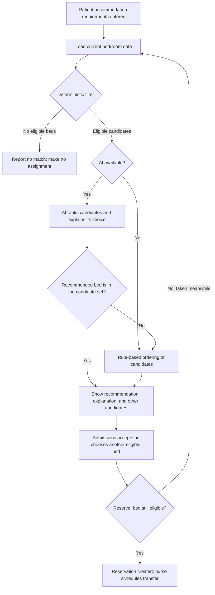
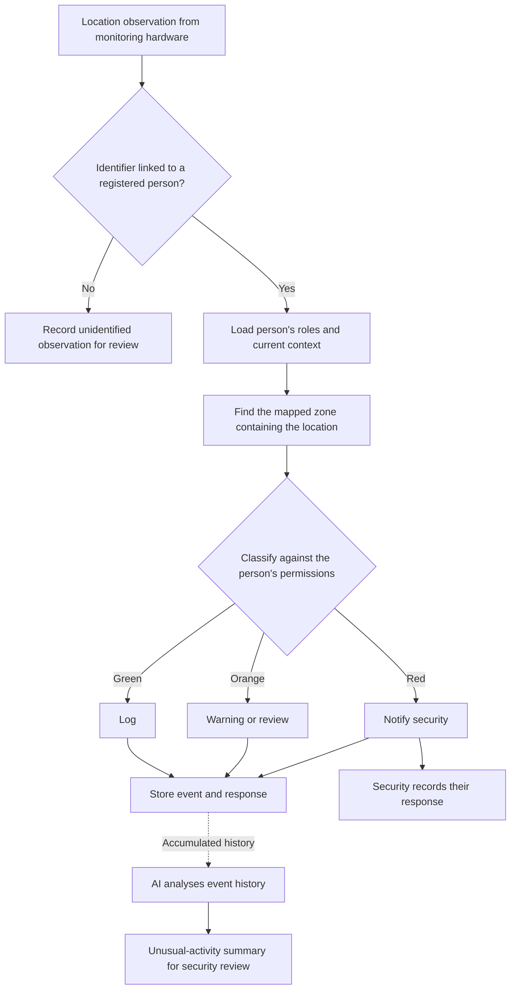

# Control, analytics, and AI

## Bed recommendation workflow

The eligibility filter checks each bed against these rules:

| Check | Rule | Requirement |
|----|----|----|
| Readiness | Status is Ready, not Cleaning or Unavailable | FR-003 |
| Occupancy | No current assignment and no active reservation | FR-007, FR-017 |
| Unit and type | Matches the requested unit or bed type | FR-004 |
| Equipment | Has every piece of required equipment | FR-004 |
| Accessibility | Meets every accessibility requirement | FR-004 |

Notes:

* The AI output is checked against the candidate set before it is shown. If the model returns a bed outside the set, or an unreadable response, the system falls back to rule-based ordering.
* The reservation step re-checks eligibility when it writes the reservation. Two admissions staff working at the same time must not be able to reserve the same bed (FR-017).
* Possible ranking factors (not yet decided): distance to the requested unit, avoiding beds with specialised equipment the patient does not need, and the expected time until the bed is required.

## 2. Security-monitoring workflow

Notes:

* Classification and red-zone notifications use rules only. The AI step runs on stored history and sits outside the alert path (FR-023).
* A person's "current context" means their visit destination, current bed/unit assignment, or staff duties (FR-020). It must reflect recent changes; for example, a closed visit has no permissions left.
* Observations older than the freshness limit are stored but are not shown as the person's current location (FR-011).

## 3. Inputs and outputs

| Function | Trigger | Inputs | Outputs | Rule or AI | Requirements |
|----|----|----|----|----|----|
| Bed eligibility | Admissions submits requirements | Patient requirements, room attributes, readiness, assignments, reservations | Eligible beds, or "no match" | Rule | FR-003, FR-004 |
| Bed recommendation | Eligible beds found | Eligible beds, patient requirements | Recommended bed, explanation, ordered alternatives | AI with rule fallback | FR-005, NFR-004 |
| Zone classification | New location observation | Person, roles and context, location, zone map, zone permissions | Green, orange, or red | Rule | FR-022 |
| Alert processing | Classification produced | Classification, event details (person, location, time) | Log entry, warning or review item, or security notification | Rule | FR-010, FR-023 |
| Activity analysis | Scheduled run or on request from security | Historical observations and security events | Unusual-activity summary | AI | FR-012 |

## 4. Data needed from the platform

These are the data this module expects the [platform](platform.md) data model to provide:

* **Beds/rooms:** unit, type, equipment list, accessibility features, location, readiness status.
* **Assignments and reservations:** current patient per bed, active reservation per bed, with a way to reserve atomically.
* **People registered for monitoring:** linked tracking identifier, roles, and current context (visit destination, patient assignment, staff duties).
* **Zone map:** zone boundaries as geometry (PostGIS, per the container diagram) and permissions per role or context.
* **Observations and events:** timestamp, location, person if identified, zone, classification, response, and staff responses to alerts.

## Open questions

* How should conflicting permissions be resolved when someone has several roles, such as a staff member who is also a patient?
* How should a location outside every mapped zone, or an unidentified observation, be classified?
* What orange-zone thresholds should apply (time spent, number of repeats) before a review is created?
* What counts as "unusual" for the activity summary, and how will it be tested beyond the FR-012 acceptance case?
* Can identities be pseudonymised before history is sent to an external LLM provider, so protected data stays within NFR-001?
* Which ranking factors should the bed recommendation use, and how will the quality of its recommendations be judged?
