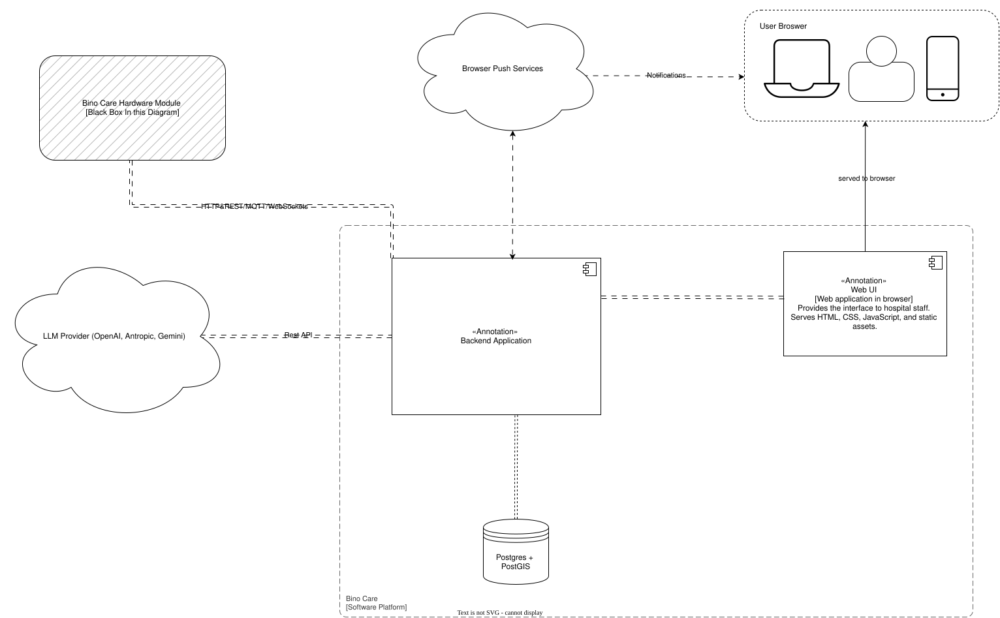
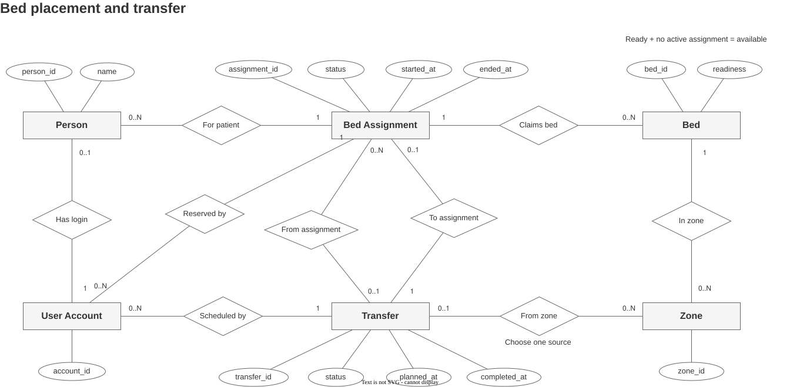
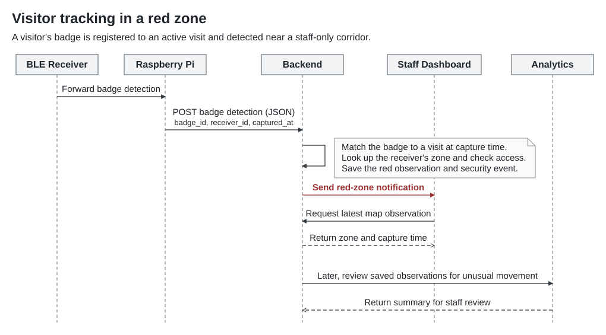

# platform

This file contains the design for the software platform. Please refer to [ui/](ui.md) for user interface software designs or [ai.md](ai.md) for analytics./AI software related designs.

# High Level Modules

This section contains the high level modules of the software system. This part excludes detailed descriptions of the hardware design (please see [hardware/](../hardware/)) and focuses solely on the design of the software platform.

## Container Diagram

 

## Description

\[TODO\]

# Data Model

The [ER diagram](diagrams/er_diagram.drawio.svg) has two pages. The first covers bed placement and transfers. The second shows the map, zone permissions, and tracking. Both use the same Person, Bed, and Zone records in PostgreSQL.

## Tables

| Table name | Description |
| --- | --- |
| `person` | Stores the identity of a patient, visitor, or staff member. |
| `user_account` | Stores a person's optional login and account status. |
| `role` | Lists roles such as patient, visitor, nurse, and admissions staff. |
| `person_role` | Links people to the roles they hold. |
| `bed` | Stores a bed's map location, equipment, accessibility, and readiness. |
| `bed_assignment` | Holds a bed for a patient and records actual occupancy once they arrive. |
| `transfer` | Records a planned move from a bed assignment or zone, the scheduling nurse, and when the patient arrived. |
| `floor` | Stores a floor's label and boundary. |
| `zone` | Stores a mapped area on one floor, such as a room or treatment bay. |
| `role_zone_rule` | Stores the default access colour for a role in a zone. |
| `visit` | Records a visitor's permitted destination and arrival and departure times. |
| `tracking_identifier` | Stores an identifier and its source, such as a tag ID from a tracking system. |
| `tracking_registration` | Links a tracking identifier to a person for a period of time and optionally to their visit. |
| `location_observation` | Records when and where a reading was captured and its zone classification when resolved. |
| `security_event` | Records a warning, notification, or staff response linked to an observation. |

# Sequence diagrams

 This diagram showcases an example of an integrated system handling when a vistor enters a red-zone area.

## Bed placement and transfers

Person represents a patient, visitor, or staff member. A person can have several roles and may have a login through User Account. Reservations and transfers record the staff account responsible for the action. Admissions enters equipment and accessibility needs in the search form. The backend uses those inputs to find suitable beds and can pass the matching beds to the recommendation service. The form is only needed for that search.

Bed Assignment links one patient, bed, and admissions account. The row starts as **Reserved** as soon as admissions holds the bed. It becomes **Occupied** when a nurse confirms arrival. The occupancy start and end times record the actual stay. An open end time means the patient is still there once occupancy has begun. **Ended** marks a finished stay, and **Cancelled** releases a reservation before arrival.

Transfer links to the destination assignment and the nurse who scheduled it. The source is either the patient's current assignment or a zone such as an ER treatment bay. The transfer stores the planned time and its progress through Scheduled, In progress, Completed, or Cancelled. If the move runs late, the old bed stays occupied and the new one stays reserved. On arrival, the same transaction records completion, starts the destination assignment, and, when there is a source assignment, ends it and marks its bed for cleaning. Cancelling releases the hold and leaves the patient in their current bed. Discharge ends the current assignment and sends that bed to cleaning.

Bed stores readiness as **Ready**, **Cleaning**, or **Unavailable**. Derive whether it is reserved or occupied from its assignments. Staff can offer a bed when it is Ready and has no Reserved or Occupied assignment. PostgreSQL should enforce one active claim per bed and one Occupied assignment per patient. Reserve and complete against the latest bed and assignment records so competing reservations or repeated completion requests cannot claim the bed twice.

## Map import

Each demo database starts with one georeferenced GeoJSON FeatureCollection. The prototype uses a single layer of zones. A room, corridor, or treatment bay can be its own zone. The [example visitor-tracking map](diagrams/example_map_geojson.geojson) contains a public zone, a restricted zone, and one BLE receiver in each.

| Feature kind | Geometry | Properties |
| --- | --- | --- |
| `zone` | Polygon | Stable `id`, `kind`, `label`, and `role_colors`. Include `unit` where applicable. |
| `ble_receiver` | Point | Stable `id`, `kind`, and `zone_id`. The point marks the receiver's installation location. |
| `bed` | Point | Stable `id`, `kind`, and `zone_id` |

**TODO** Remove the `Floor` entity, `floor_id`, and floor-dependent wording from the platform data model, ER diagram, and UI design.

On first startup, validate the geometry, unique feature IDs, `zone_id` links, role names, and colours. In one PostGIS transaction, seed zones and import each `role_colors` entry as a Role–Zone Rule, then seed receiver configuration. For bed layouts, import bed points after their zones and store equipment and accessibility on Bed.

The Raspberry Pi sends the receiver feature's `id` as `receiver_id`. The backend looks up that receiver's `zone_id` and applies the tracked person's access rule for that zone. In the example, `receiver-01` produces a green observation for a registered visitor. `receiver-02` produces a red observation and a security notification.

A restart with the same layout keeps the imported IDs, staff edits, and operational records. Use a separate demo database for another layout.

## Monitoring and security

Visit links a visitor to a permitted destination zone and records their arrival and departure. Tracking Registration links a person to a tracking identifier for a time window. A registration can belong to a visit. Each person has one active monitoring context, with an applicable role chosen from their roles. Each tracking identifier can be linked to only one person at a time. Ending a visit ends its permission and registration.

Location Observation records capture time and the reported location. The system matches the identifier to the registration valid at capture time, so reusing a tag keeps the two visitors' histories separate. A reading can report a zone ID or a position on a floor. Keep the observation if the person or zone is unresolved, including points on ambiguous zone boundaries.

The Role–Zone Rule supplies the default colour. A permitted visit destination or the patient's current bed can make an orange zone green for that person. Red stays restricted. Save the applied colour when it can be resolved. Green readings stay in the observation history. Orange can prompt a warning or review. Red triggers a security notification. Security Event links the warning, notification, or staff response to the observation that prompted it.

Will the tracker report a zone ID or a position that needs to be aligned to the floor map? The observation model supports both.
